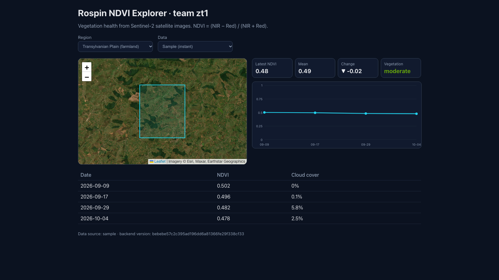

# Rospin NDVI Explorer

[](LICENSE)


See how healthy the vegetation is in four Romanian regions, from **Sentinel-2** satellite images. No account, no API key. NDVI = (NIR - Red) / (NIR + Red): above 0.6 is healthy vegetation, near 0.1 is bare soil.



This is the **Apps** repository of the cloud workshop (ROSPIN Space Talks), usable on its own. Its companion is [ROSPIN_Workshop_Infra](https://github.com/agi1clj/ROSPIN_Workshop_Infra), which has the Terraform and the step-by-step walkthrough. Both are GitHub template repositories.

Data needs no account or API key. The default *Sample* source is instant and works offline. *Live Sentinel-2* reads real satellite files and takes about a minute.

## Run locally

```bash
docker compose up --build
```

- App: http://localhost:3000
- API docs: http://localhost:8000/docs

Stop with `Ctrl+C`, then `docker compose down`.

## Deploy to Azure

Follow the [walkthrough](https://github.com/agi1clj/ROSPIN_Workshop_Infra/blob/main/docs/walkthrough.md) in the Infra repository. After setup, every push to `main` that changes `backend/` or `frontend/` is tested, built into an image, pushed to Azure Container Registry and rolled out to Azure Container Apps.

## Your challenge (use your AI agent)

Open this folder in Claude Code, Gemini CLI, Codex or Copilot. They read `AGENTS.md` first. Ask the agent to add something, review the diff, push, and watch GitHub Actions deploy it. Ideas: a new region (your city), a forest-loss comparison, an NDVI colour legend on the map, a `/api/regions/{id}/ndvi` field for the best scene.

## Live deployment (fill in)

- Frontend: <https://...>
- Backend: <https://.../docs>

## Architecture



## Data and credits

Contains modified Copernicus Sentinel-2 data (2026), read from the public Earth Search catalogue and AWS Open Data archive. Map imagery (c) Esri, Maxar, Earthstar Geographics. App inspired by the agriculture analytics project [Virdis](https://github.com/Thanas-R/Virdis); no code was copied.

## Contributing and license

[Contributing](CONTRIBUTING.md) · [Code of conduct](CODE_OF_CONDUCT.md) · [Security](SECURITY.md) · [MIT license](LICENSE)
